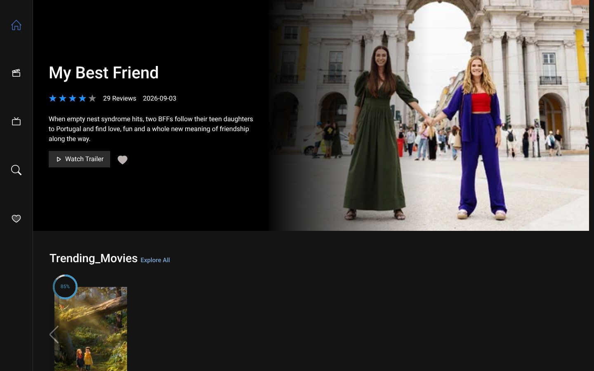
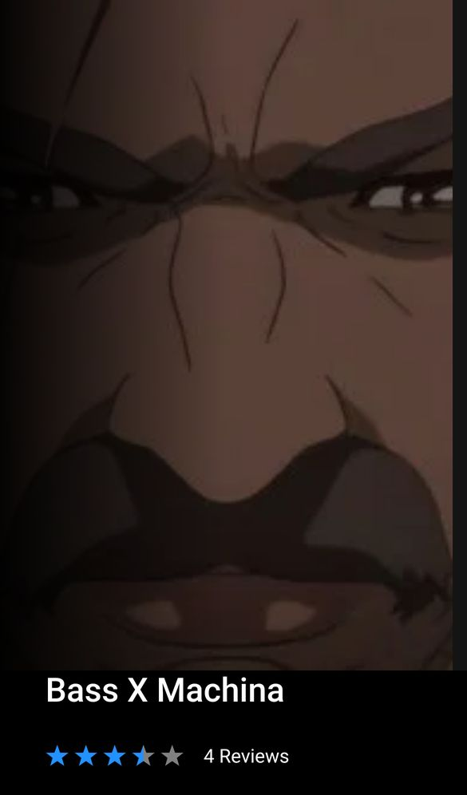

<div align="center">

# Drama

### A movie and TV browser built on the TMDB API

A React single-page app for browsing trending, popular and upcoming movies and TV shows. You can open any title for its overview, cast, episodes, trailers and photos, and save favourites in the browser.

[](https://react.dev)
[](https://reactrouter.com)
[](https://getbootstrap.com)
[](https://sass-lang.com)
[](https://swiperjs.com)
[](https://axios-http.com)
[](https://vitejs.dev)
<br>
[](https://splendorous-snickerdoodle-50ec5e.netlify.app/)
[](https://www.themoviedb.org)

**[Live demo](https://splendorous-snickerdoodle-50ec5e.netlify.app/)** ·
**[Portfolio](https://new-portfolio-ashy-xi.vercel.app/)** ·
**[LinkedIn](https://www.linkedin.com/in/eslamraafat-dev/)** ·
**[Email](mailto:eslamraafat736@gmail.com)**

<br>



</div>

<table>
  <tr>
    <td width="33%" align="center"></td>
  </tr>
  <tr>
    <td align="center"><sub>Mobile (iPhone 13)</sub></td>
  </tr>
</table>

---

## Contents

- [Overview](#overview)
- [Features](#features)
- [Tech stack](#tech-stack)
- [Routes](#routes)
- [Project structure](#project-structure)
- [Getting started](#getting-started)
- [Deployment](#deployment)
- [Author](#author)

## Overview

Drama is a **personal practice project** from 2023. I built it from a third-party UI design by Jason Ujma-Alvis (credited in the site footer); the code is mine. All movie and TV data comes from [The Movie Database (TMDB)](https://www.themoviedb.org) API.

What I practised:

- nested routes and layouts with **React Router 6** (`createHashRouter`, `<Outlet>`),
- a reusable data-fetching hook (`UseFetchData`) on top of an Axios client,
- global state with the **Context API**, persisted to `localStorage`,
- infinite scrolling, carousels, modals and skeleton loaders,
- component styles in **SCSS** with shared variables and mixins.

## Features

### Browsing

- **Home** shows a hero for a trending title, plus carousels of upcoming movies and trending TV shows.
- **Movies** has carousels for popular, top-rated, upcoming and now-playing movies.
- **TV** has carousels for popular, top-rated, airing-today and currently-airing shows.
- **"Explore All"** opens a full grid for any carousel. More results load as you scroll (infinite scroll).
- **Search** finds movies as you type, also with infinite scroll.

### Title pages

- The hero shows the title, star rating, review count, release date and overview.
- **Watch Trailer** opens a YouTube trailer in a modal (React Player).
- Tabs:
  - **Overview**: details and a cast carousel.
  - **Episodes**: TV only, with a season selector.
  - **Videos**.
  - **Photos**: images open in a slideshow lightbox.
- **More like this** lists similar titles.

### Favourites

- A heart button adds or removes a title. Favourites are saved in `localStorage`, so they survive a reload.
- The Favourites page counts saved titles, filters them by movie or TV, and removes them.

### UI

- Cards show a star rating and a circular score indicator.
- Skeleton and pagination loaders show while data loads.
- A fixed icon side navigation with tooltips, built with React Bootstrap `OverlayTrigger`.

## Tech stack

| Layer | Tools |
| --- | --- |
| UI library | React 18.2 |
| Routing | React Router 6.15 (hash router) |
| Styling | Bootstrap 5.3, React Bootstrap 2.8, Sass (SCSS modules per component) |
| Data | Axios 1.5, TMDB API v3 (bearer token) |
| Carousels and media | Swiper 10, React Player 2.13, lightbox.js-react |
| Ratings | react-star-ratings, react-circular-progressbar |
| Icons | react-icons |
| Build tool | Vite 4 |
| Hosting | Netlify |

## Routes

The app uses a hash router, so every URL starts with `/#/`.

| Route | Page |
| --- | --- |
| `/` | Home |
| `/movie`, `/tv` | Movie and TV landing pages |
| `/movie/TargetFilm/:id/OverView` · `/EPISODES` · `/video` · `/PHOTOS` | Title page tabs (same under `/tv/...`) |
| `/:category` | "Explore All" grid for a carousel, e.g. `/Popular_Movies` |
| `/Search` | Movie search |
| `/Favorites` | Saved favourites |

## Project structure

```text
src/
├── App.jsx                 # hash router and route tree
├── main.jsx                # global styles + context provider
├── pages/                  # Home, Film, Tv, All (explore grid), Search, Favourite
├── layouts/                # AppLayout (side nav + footer), FilmTvLayout, TargetFilmLayout (title page tabs)
├── components/
│   ├── trilerHero/         # hero with trailer button and favourite toggle
│   ├── categories/         # Swiper carousels and the cast carousel
│   ├── overView/ EPISODES/ PHOTOS/ videoView/   # title page tabs
│   ├── videoPopup/         # YouTube trailer modal
│   ├── card/ sideNav/ footer/
│   └── skilton/            # skeleton and pagination loaders
├── hooks/UseFetchData.jsx  # fetch hook: data / loading / error
├── store/MoveIdContext.jsx # context: current title, type, favourites (localStorage)
├── utils/                  # Axios TMDB client, star rating, helpers
└── scss/                   # shared variables and mixins
```

## Getting started

**Requirements:** Node.js 18 or newer, npm, and a free [TMDB API read access token](https://developer.themoviedb.org/docs/getting-started).

```bash
git clone https://github.com/Eslamraafat1/Drama-Movies.git
cd Drama-Movies
npm install
echo "VITE_APP_TMDB_TOKEN=<your TMDB read access token>" > .env
npm run dev        # http://localhost:5173
```

| Command | What it does |
| --- | --- |
| `npm run dev` | Start the Vite dev server |
| `npm run build` | Production build to `dist/` |
| `npm run preview` | Serve the production build locally |
| `npm run lint` | Run ESLint |

## Deployment

The live demo is hosted on **Netlify** as a static Vite build. The repo also contains a `vercel.json` with an SPA rewrite, so it can be deployed to Vercel as well.

This product uses the TMDB API but is not endorsed or certified by TMDB.

## Author

**Eslam Raafat** — Front-End Developer (React · Next.js · TypeScript)

- **Portfolio:** [new-portfolio-ashy-xi.vercel.app](https://new-portfolio-ashy-xi.vercel.app/)
- **LinkedIn:** [linkedin.com/in/eslamraafat-dev](https://www.linkedin.com/in/eslamraafat-dev/)
- **GitHub:** [@Eslamraafat1](https://github.com/Eslamraafat1)
- **Email:** [eslamraafat736@gmail.com](mailto:eslamraafat736@gmail.com)
